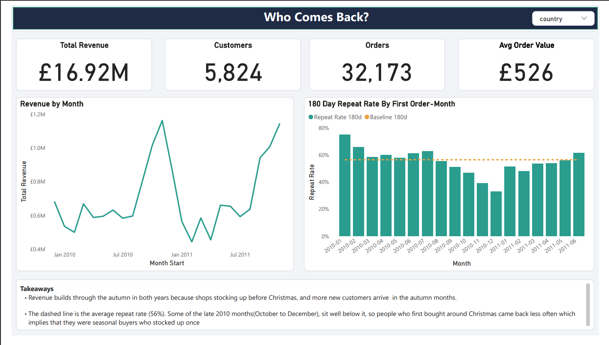

# Who Comes Back? Repeat-Purchase and Customer Value Analysis

An analysis of two years of transactions from a UK online gift retailer, built to answer one question: **which customers come back to buy again, and what sets them apart?** The results are in a four-page Power BI dashboard, supported by a reproducible Python analysis.

## Key findings

| Finding | Number |
|---|---|
| New customers who reordered within 180 days | **56.4%** |
| Median days to a second order (among those who came back) | **68** |
| Repeat rate: largest vs smallest quarter of first orders | **64.5%** vs **45.6%** |
| Average vs median first-year revenue per customer | **£1,565** vs **£735** |
| Share of revenue from the top 10% of customers | **63.5%** |
| Share of a cohort still ordering in month 1 / month 12 | **21.0%** / **18.4%** |
| Previously frequent customers who have gone quiet ("at risk") | **667**, about £1.5M past revenue |

Every finding is labelled strong, moderate or tentative in [`findings.md`](findings.md). In short, the gateway-product results are leads to investigate, not proof that any product causes repeat buying.

## Dashboard pages

| Page | What it shows |
|---|---|
| Overview | Revenue, customers, orders, monthly revenue trend, and 180-day repeat rate by first-order month |
| Retention | Share of each starting-month cohort still ordering 1, 3, 6 and 12 months later |
| LTV | Revenue per customer over time, and first-year revenue by size of first order |
| Gateway | Products in a first order that are linked to higher repeat rates, with the caveats |

Screenshots (overview.png, retention.png, ltv.png, gateway.png) and a PDF export (who_comes_back.pdf) are in this repository.

## How it was built

1. **Clean the data** (`day_1_analysis_v2.py`): set aside returns, remove postage and fee lines, remove rows with no customer ID, and drop the incomplete final month.
2. **Define cohorts** by each customer's first purchase month. Customers first seen in the file's first month are excluded from cohort, repeat and LTV figures, because their true first order is unknown.
3. **Calculate** repeat rate, retention, 365-day revenue, first-order value bands, gateway products and RFM segments.
4. **Build the dashboard** in Power BI from the output tables, with DAX measures written for each page.

Full definitions and every cleaning count are in [`methodology.md`](methodology.md).

## Reproduce it

1. Download **Online Retail II** from the [UCI Machine Learning Repository](https://archive.ics.uci.edu/dataset/502/online+retail+ii) and save it as `online_retail_II.csv`. Check the licence on that page.
2. Install the requirements: `pip install pandas numpy`
3. Run: `python analysis/day_1_analysis_v2.py online_retail_II.csv`
4. The script writes a `day_1_outputs` folder with the tables used in the dashboard and a `summary.txt` with the cleaning log, built-in checks and headline numbers.

The raw dataset is not included in this repository.

## Limitations

- The data is from 2009 to 2011.
- The retailer sells mostly to other businesses, so repeat rates and order values are higher than a typical consumer shop.
- About 13% of sales have no customer ID and are excluded.
- Revenue is gross of returns, which are roughly 7% of gross sales.
- Retention counts calendar months, so it understates activity for customers who order every few months.
- Gateway-product results are associations only. Large first orders repeat more anyway, groups are small, and 607 products were compared.
- Seasonality is visible but not controlled for.

## Tools and AI use

I used an AI assistant to help write the Python analysis script. I reviewed the logic, ran it, and checked the results against the raw data. I designed and built the Power BI dashboard myself.

## Data source

Chen, D. *Online Retail II* dataset, UCI Machine Learning Repository. 

## About me

Akinwale Ifeoluwa Aderonke | Data analyst | https://www.linkedin.com/in/ifeoluwa-akinwale/ | akinwaleifeoluwa54@gmail.com
